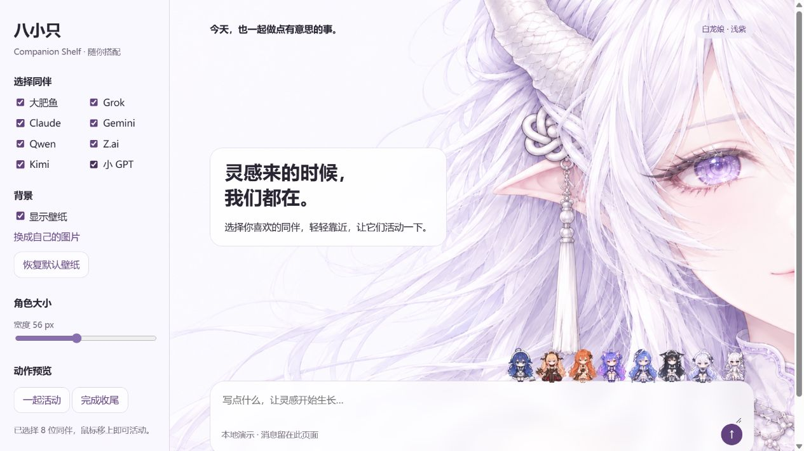

# 八小只 · AI Companion Shelf

八位会回应鼠标的 Q 版同伴，坐在输入框或任意页面元素上沿。**默认包是白龙娘壁纸＋浅紫界面＋八小只**，也能单只使用、自由组合、关闭或替换背景。

不需要 Dream Skin、不需要 API Key、不连接 AI 服务。演示页中的文字和本地图片留在本地。Dream Skin 是可选宿主，不包含在下载包中。



## 直接下载使用

打开 [Releases](https://github.com/unknown-sama-ff/ai-companion-shelf/releases/latest)。

| 下载文件 | 用途 |
| --- | --- |
| `ai-companion-shelf-1.0.0.zip` | 完整包：壁纸、浅紫配色、八小只及 Dream Skin 适配代码 |
| `companion-角色ID-1.0.0.zip` | 单角色独立包，可开关和替换壁纸 |
| `white-dragon-lavender-1.0.0.zip` | 供 Dream Skin 导入的默认主题 |
| `SHA256SUMS.txt` | 下载包的 SHA-256 校验值 |

解压完整包或单角色包，**双击 `index.html`**。无需安装 Node、Python，也不用启动本地服务。

左侧可选择角色、调整大小、关闭壁纸、恢复默认壁纸或选择本地图片。鼠标停留时持续活动，移开后正向完成收尾，Tab 聚焦也可触发。输入框仅在当前页面展示演示文字。

GitHub **Code → Download ZIP** 下载的是源码；生成可直接打开的包，请按下文构建。

## 八位同伴

| ID | 角色与动作 |
| --- | --- |
| `big-fish` | 大肥鱼端碗夹饭、咀嚼，移开后放碗；24帧、20fps，一轮1.2秒 |
| `grok` | 向用户前举斧、歪头邪魅一笑，轻晃武器并眨眼，随后收斧回正 |
| `claude` | 低头看书、翻页、发梢轻扬，合书后抬眼 |
| `gemini` | 小猫举爪学老虎、嘴型变化、摇尾巴，随后收爪回位 |
| `qwen` | 打开折扇、端庄轻扇，收扇放回身边 |
| `zai` | 戴眼罩、侧头轻摆，梦中上传代码，醒来摘眼罩 |
| `kimi` | 戴有线入耳式耳机摇摆听歌，收住摇摆、暂停、收手 |
| `gpt` | 扇翅小浮空、向下喷火，停火落地收翅 |

## 嵌入其他网页或应用

复制下载包中的 `companion-shelf.js`，挂在任意元素上沿：

```html
<div id="my-input">你的输入区域或其他容器</div>
<script src="companion-shelf.js"></script>
<script>
  CompanionShelf.mount({
    target: '#my-input',
    characters: ['grok', 'kimi'],
    layout: { characterWidth: 56, gap: -8, rightInset: 8 }
  });
</script>
```

此用法默认只显示角色。加 `wallpaper: true` 使用默认壁纸；传 `wallpaper: './your-image.jpg'` 使用其他图片。`characters` 数组可只包含一个角色，也可任意组合、排序。

完整 API 见 [网页嵌入](docs/EMBEDDING.md)。Electron/WebView 等网页宿主可以复用；跨应用置顶桌宠需要自己的透明窗口壳，本项目不包含这部分桌面功能。角色没有聊天接口，名称代表非官方同人形象。

## Dream Skin 与其他背景

见 [Dream Skin 使用说明](docs/DREAM-SKIN.md)。默认主题 ZIP 包含当前白龙娘图片和浅紫配色；角色适配器不绑定这张图片，在 Dream Skin 中换主题后仍可使用。

编辑 `companion-settings.json` 选择角色与顺序，然后从托盘重新应用。例如只显示小 GPT 和 Kimi：

```json
{
  "characters": ["gpt", "kimi"],
  "layout": { "characterWidth": 56, "gap": -8, "rightInset": 8, "overlap": 3 }
}
```

## 从源码构建

需要 Node.js 22+；打 ZIP 需要 Python 3.11+（仅用标准库）。浏览下载包无需这些环境。

```sh
npm test
npm run build
python scripts/package-release.py
```

完整独立版位于 `dist/full/`，单角色版位于 `dist/characters/<id>/`，ZIP 与校验文件位于 `dist/`。也可执行 `npm run preview`，打开 `http://127.0.0.1:4173/`。

## 实现说明

- 无第三方运行时依赖，共用一个透明 WebGL 画布和刷新调度，备用路径为图片混合。
- 清单 `assets/companions.json` 保存阶段帧序、落座校准和运动数据。
- 入场、循环与独立正向收尾；快速进出按最新悬停意图完成动作。Kimi 从指定姿势接入收尾。
- 输入框上方有继续、重试、排队消息等提示条时，同伴自动移到提示条上方，消失后恢复原位；不修改输入框留白。
- 构建后的 JS 内嵌素材，离线页不请求图片服务器；后台暂停，支持系统减少动态效果。
- 更换图集后可运行 `python scripts/build-motion-fields.py --character kimi` 重算，需要 Pillow、NumPy。
- 打包仅包含当前使用的素材，排除原始参考图、旧图集、安装收据、日志和本机应用配置。

## 许可与素材

代码、文档采用 [MIT 许可](LICENSE-CODE)。**人物图集、壁纸、人物设定与品牌名称不在代码的 MIT 许可内**，详见 [ASSETS.md](ASSETS.md)。本项目没有相关品牌的官方合作或背书。

代码和图片使用 AI 辅助生成并通过交互反馈迭代。包内不含 Codex、ChatGPT 或 Dream Skin 的程序、令牌、运行配置及聊天数据。
